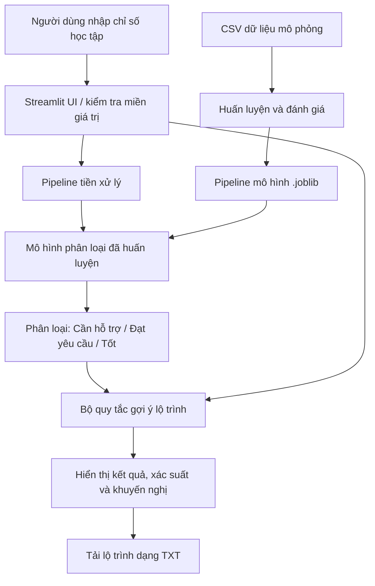

# Thiết kế hệ thống

## Kiến trúc logic

## Thành phần
1. **Giao diện:** Streamlit nhận các chỉ số và hiển thị dự đoán.
2. **Tiền xử lý:** `SimpleImputer(strategy="median")` xử lý giá trị thiếu; `StandardScaler` chuẩn hóa các biến số.
3. **Mô hình:** Random Forest, được chọn trong lần chạy hiện tại theo Macro-F1 trên tập test.
4. **Bộ gợi ý:** quy tắc dễ giải thích, ưu tiên chỉ số dưới ngưỡng rồi thêm gợi ý theo nhóm dự đoán.
5. **Đánh giá:** tập kiểm thử giữ riêng; so sánh Accuracy, macro-Precision, macro-Recall, macro-F1 và confusion matrix.

## An toàn và đạo đức
- Không nhập dữ liệu định danh như họ tên, MSSV hoặc email vào mô hình.
- Dữ liệu thật chỉ được dùng khi có quyền sử dụng, được phê duyệt và ẩn danh phù hợp.
- Kết quả là gợi ý hỗ trợ, không tự động quyết định học vụ.
- Cần kiểm tra sai lệch giữa các nhóm sinh viên trước khi triển khai thực tế.
